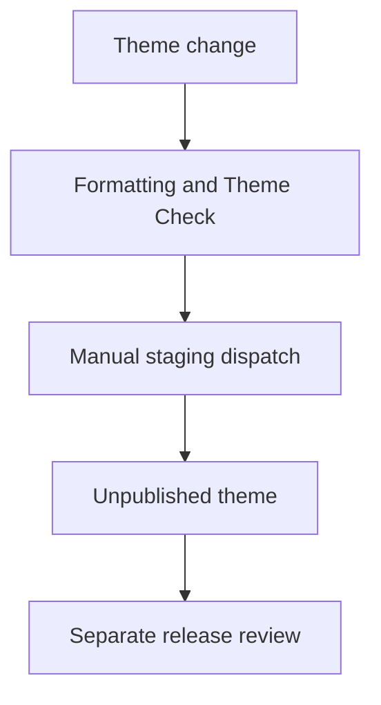

# Shopify Theme Delivery Blueprint

An internal theme-engineering baseline defining section ownership, responsive image behavior, formatting checks and deliberate staging delivery.

**Technical showcase · Documentation only · Anonymized**

Shopify | Liquid | CSS | JavaScript | Shopify CLI | Theme Check | GitHub Actions

## Engineering problem

A reusable baseline should make normal theme work predictable without disguising reference code as a finished client deployment or silently publishing to production.

## Implementation scope

- Documented native theme architecture across sections, templates, snippets, assets and global configuration.
- Implemented an editable hero section using responsive Shopify images with intrinsic dimensions and explicit loading behavior.
- Defined formatting and Theme Check gates for code changes.
- Added a manually triggered workflow targeting an unpublished theme.
- Documented responsive, editor, accessibility and performance evidence expectations and approval boundaries for publishing.

## Architecture at a glance

The following is an illustrative technical flow, not a client screenshot or a deployment topology.

## Evidence and delivery boundary

Implemented reference baseline, not a completed client launch.

The inspected baseline contains quality and staging workflow definitions. Browser end-to-end coverage is not claimed: the inspected end-to-end directory is a documented placeholder rather than a complete suite.

## Read more

- [Engineering decisions](docs/engineering.md)
- [Scope and evidence boundaries](docs/scope.md)

> This repository describes verified implementation work at a technical level. Original source, identities, business data and visual assets are intentionally omitted. It is not an installable application or a claim that the original private implementation is open source.
