# Engineering design

## Contract

`ReleaseGate.prepare` accepts a target ID, exact non-negative integer revision, and candidate files plus check evidence. Files have the exact shape `{ path, content }`; extra keys are rejected. Evidence binds a named result to the candidate hash.

Prepare validates an unpublished target at the exact revision, computes the canonical manifest, requires `format` and `theme-check-synthetic`, and freezes an authoritative private plan. Returned metadata is display-only.

`ReleaseGate.apply` requires the token, target ID and exact revision again. It rechecks role and revision, rejects revision overflow before mutation, consumes the plan immediately before invoking one compare-and-swap, then verifies readback identity, unpublished role, exact incremented revision and bytes. After write invocation, every error leaves the token consumed because an adapter can commit and then throw; callers must reconcile/read back and prepare a fresh plan rather than automatically retry.

## Canonical manifest

For each file the implementation computes `SHA256(UTF-8 content)`. Files sort by exact JavaScript string code-unit comparison, avoiding locale-dependent collation and preserving a strict order for Unicode-distinct spellings. Each entry is `<path> NUL <content-sha256> LF`; the artifact digest is SHA-256 of all entries. Caller array order cannot alter identity, but path spelling and content bytes do.

## State flow

```mermaid
stateDiagram-v2
    [*] --> Candidate
    Candidate --> Rejected: invalid manifest or evidence
    Candidate --> Prepared: unpublished target at exact revision
    Prepared --> Prepared: preflight refusal before write attempt
    Prepared --> Attempted: token consumed; CAS invoked
    Attempted --> Reconcile: CAS throws; outcome may be committed
    Attempted --> Applied: CAS returns after committing manifest
    Applied --> Verified: readback hash matches
    Applied --> VerificationFailed: readback hash differs
```

A faulty adapter can commit and then throw or return different bytes. Either outcome is fail-closed with the plan consumed. It is not disguised as success, automatically retried, or claimed to be rolled back.

## Failure matrix

| Condition | Result | Target mutation | Plan consequence |
|---|---|---|---|
| Unsafe path, duplicate, sparse manifest | Prepare refuses | None | None created |
| Missing, failed, stale check | Prepare refuses | None | None created |
| Wrong/live target or stale revision | Refuse | None | Valid plan retained before write |
| Caller mutates input/display fields | Frozen plan wins | Exact prepared files only | Normal single use |
| Adapter throws without mutation | Apply refuses | None in a known test adapter | Consumed; fresh prepare required |
| Adapter commits then throws | Apply refuses with ambiguous outcome | Full manifest may be present, revision +1 | Consumed; reconcile before fresh prepare |
| Revision at `Number.MAX_SAFE_INTEGER` | Refuse before write | None | Valid plan retained |
| Successful CAS | Apply proceeds to verification | Full manifest, revision +1 | Already consumed before invocation |
| Replay | Apply refuses | None | Already consumed |
| Readback throws, is malformed, or differs in ID/role/revision/bytes after commit | Post-write verification failure | May already be changed | Consumed; unsafe to replay |

## Trust boundary

The caller is a trusted release harness. The opaque token prevents accidental substitution and replay inside the process, but is not identity or authorization. Holding it permits the frozen operation only while target checks pass. A real service must authenticate actors, authorize target access, protect and expire capabilities, and write redacted audit records.

The private registry is authoritative. Changing returned target, revision, hash or file count cannot change application behavior. Files are copied and frozen before storage.

## Concurrency semantics

Every target mutation increments revision, and mutation is refused when no safe-integer successor exists. An ABA sequence—old bytes → different bytes → old bytes—therefore invalidates a prepared plan. This is single-process in-memory CAS, not a database transaction or distributed lock.

## Production adapter responsibilities

1. Independently prove the remote theme is unpublished at prepare and apply time.
2. Map a platform revision/generation to an atomic conditional update, or compensate safely if unavailable.
3. Package the exact bounded manifest without following symlinks or escaping a trusted workspace.
4. Run real formatting and Theme Check and bind immutable evidence to packaged bytes.
5. Handle partial writes, retries, idempotency, rate limits and reconciliation.
6. Authenticate, authorize, expire capabilities and audit without secrets.
7. Preserve the no-live-target invariant. Publishing remains separate and is never implemented here.

## Trade-offs

A planning-only verifier would be simpler but would not demonstrate stale revisions, single-use plans, failure atomicity or readback. The in-memory adapter makes those behaviors executable without pretending to provide Shopify delivery.

In-memory hashing is appropriate at the one-megabyte ceiling. A production packager should stream large inputs and retain an immutable artifact instead of rereading a mutable workspace.